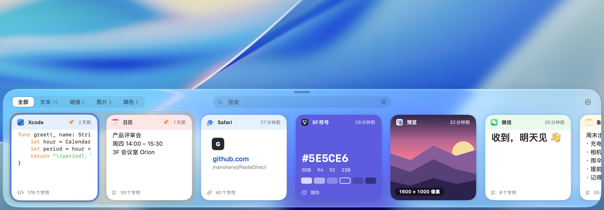
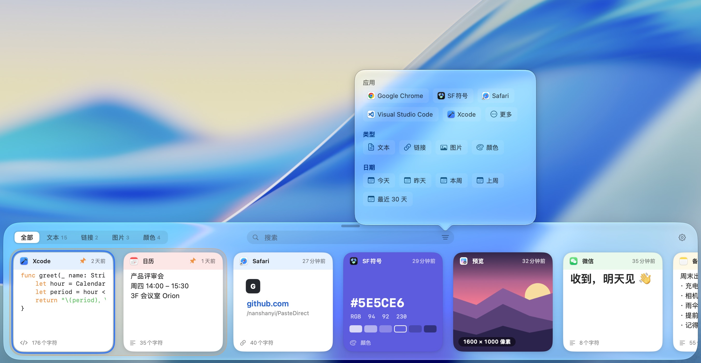
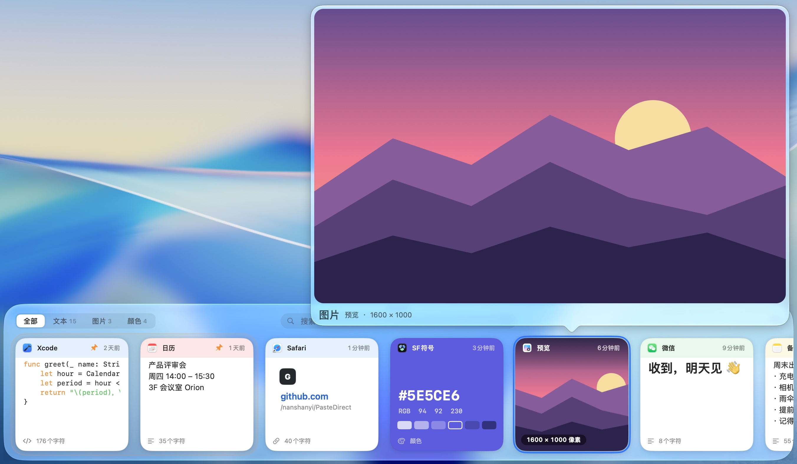

<p align="center">
  
</p>

<h1 align="center">PasteDirect</h1>

<p align="center">
  轻量、安全、纯本地的 macOS 剪贴板历史管理工具
</p>

<p align="center">
  <a href="https://github.com/nanshanyi/PasteDirect/releases/latest"></a>
  <a href="https://github.com/nanshanyi/PasteDirect/releases"></a>
  
  
  <a href="LICENSE"></a>
</p>

<p align="center">
  <a href="https://github.com/nanshanyi/PasteDirect/releases/latest"><b>⬇️ 下载最新版本</b></a>
  ·
  简体中文 | <a href="README_EN.md">English</a>
</p>

<picture>
  <source media="(prefers-color-scheme: dark)" srcset="docs/images/main-dark.jpg">
  
</picture>

## 特性

### 📋 什么都能记

- **多格式** — 文本、图片、HTML、RTF、富文本、代码片段都会被记录
- **颜色识别** — 自动识别 Hex 颜色值，卡片直接显示色块与 RGB
- **图片文字识别（OCR）** — 基于系统 Vision 框架在本地识别图中文字，图片也能被搜索到
- **条目置顶** — 常用内容一键置顶，始终排在最前，不受历史清理影响

### 🔍 很快就能找到

- **即时搜索** — 呼出面板后直接打字即可过滤，图片中的文字也能搜
- **组合筛选** — 顶部分段按类型切换并显示条数，还可叠加来源应用、时间范围筛选
- **空格预览** — 按空格放大查看文本、图片、颜色详情；预览图片时支持实况文本，可直接框选复制图中文字

<picture>
  <source media="(prefers-color-scheme: dark)" srcset="docs/images/filter-dark.jpg">
  
</picture>

<picture>
  <source media="(prefers-color-scheme: dark)" srcset="docs/images/preview-dark.jpg">
  
</picture>

### ⚡ 粘贴不打断

- **多种粘贴方式** — 双击、回车，或直接拖拽到目标位置
- **⌘1–9 快速粘贴** — 按住 `⌘` 显示卡片序号，按对应数字即可粘贴
- **纯文本粘贴** — 右键「以纯文本粘贴」，或在设置中开启「始终以纯文本粘贴」
- **直接粘贴** — 选中后自动粘贴回之前的应用，无需再按 `⌘V`

### 🔒 隐私优先

- **纯本地存储** — 所有数据保存在本机 SQLite 数据库，不上传任何内容；唯一的网络请求是检查更新
- **忽略应用** — 不记录指定应用（如钥匙串、密码管理器）复制的内容
- **自动清理** — 历史保留 1 天 / 1 周 / 1 月 / 永久，可随时一键清空

### 🪟 原生体验

- 适配 macOS 26 液态玻璃（Liquid Glass），跟随系统深色 / 浅色模式
- 卡片头部取来源应用的主色，一眼分辨内容来自哪里
- 拖拽面板顶部即可调整高度，内容等比缩放
- 基于 [Sparkle](https://sparkle-project.org/) 的应用内自动更新

## 安装

1. 从 [Releases](https://github.com/nanshanyi/PasteDirect/releases/latest) 下载最新的 `.dmg`，将 `PasteDirect.app` 拖入「应用程序」。
2. **首次打开**：应用使用自签名证书，系统会提示无法验证开发者。前往「系统设置 → 隐私与安全性」，点击「仍要打开」。也可以在终端执行：

   ```bash
   xattr -cr /Applications/PasteDirect.app
   ```

3. **授予辅助功能权限**：首次启动会弹出授权提示，这是监听剪贴板与模拟粘贴所必需的。

   

之后的版本可直接在应用内更新，辅助功能权限会自动保留，无需重新授权。

## 使用

按 `⌘⇧V`（可自定义）呼出面板，然后：

| 操作 | 说明 |
|------|------|
| 直接输入 | 搜索；`Backspace` 可逐个移除筛选条件 |
| `←` `→` | 切换选中项 |
| `Enter` / 双击 | 粘贴选中项 |
| `⌘1` – `⌘9` | 粘贴对应序号的卡片（按住 `⌘` 显示序号） |
| `Space` | 预览选中项 |
| `Delete` | 删除选中项 |
| `Esc` | 依次关闭预览 / 筛选弹窗 / 清空搜索 / 关闭面板 |
| 拖拽 | 将卡片拖到目标位置直接粘贴 |
| 右键 | 置顶、以纯文本粘贴、复制图中文字等更多操作 |

鼠标悬停在卡片上时会出现置顶 / 删除按钮，点击即可操作。

## 设置

<p align="center">
  
</p>

| 选项 | 说明 |
|------|------|
| 开机启动 | 登录时自动运行 |
| 状态栏图标 | 显示 / 隐藏菜单栏图标 |
| 直接粘贴 | 选中后自动粘贴到当前应用 |
| 始终以纯文本粘贴 | 去除格式，仅粘贴纯文本 |
| 自动识别图片中的文字 | 对复制的图片做 OCR；关闭后仍可在右键菜单中手动取用 |
| 历史保留时长 | 1 天 / 1 周 / 1 月 / 永久 |
| 忽略应用 | 不记录这些应用复制的内容 |
| 快捷键 | 自定义全局呼出快捷键 |
| 自动更新 | 自动检查新版本，可选后台静默下载、退出时安装 |

## 隐私与数据

- 剪贴板历史只保存在本机：`~/Library/Containers/com.nanshanyi.PasteDirect/Data/Library/Application Support/paste/`
- 除了向 GitHub Pages 请求更新信息（[appcast](https://nanshanyi.github.io/PasteDirect/appcast.xml)）外，应用不会发起任何网络请求。
- 彻底卸载：删除 `/Applications/PasteDirect.app` 以及 `~/Library/Containers/com.nanshanyi.PasteDirect`。

## 常见问题

<details>
<summary><b>按回车 / 双击后没有粘贴出来？</b></summary>

通常是辅助功能权限失效。打开「系统设置 → 隐私与安全性 → 辅助功能」，如果列表里已有 PasteDirect，先用 `−` 删除，再重新添加并打开开关。
</details>

<details>
<summary><b>提示「已损坏」或「无法验证开发者」？</b></summary>

这是自签名应用的正常提示，参见上方[安装](#安装)第 2 步。
</details>

<details>
<summary><b>为什么某些内容没有被记录？</b></summary>

检查是否把来源应用加入了「忽略应用」，或超出了历史保留时长被自动清理。
</details>

## 从源码构建

需要 macOS 13.0+、Xcode 16+。

```bash
git clone https://github.com/nanshanyi/PasteDirect.git
cd PasteDirect
open PasteDirect.xcodeproj
```

选择 `PasteDirect` scheme 运行即可，依赖由 Swift Package Manager 自动拉取。

> [!TIP]
> Debug 构建以 `-DemoData YES` 启动时会使用独立的演示数据库并写入示例数据，适合截图或调试 UI，不会影响真实的剪贴板历史。

发版流程见 [docs/RELEASE.md](docs/RELEASE.md)，版本历史见 [CHANGELOG](CHANGELOG.md)。

## 致谢

| 库 | 用途 |
|----|------|
| [KeyboardShortcuts](https://github.com/sindresorhus/KeyboardShortcuts) | 全局快捷键 |
| [SQLite.swift](https://github.com/stephencelis/SQLite.swift) | 本地数据库 |
| [SnapKit](https://github.com/SnapKit/SnapKit) | Auto Layout |
| [Sparkle](https://github.com/sparkle-project/Sparkle) | 应用内自动更新 |

## 参与贡献

欢迎通过 [Issues](https://github.com/nanshanyi/PasteDirect/issues) 反馈问题或提出建议，也欢迎提交 Pull Request。如果觉得好用，请点个 ⭐️ 支持一下。

## License

本项目基于 [GNU Affero General Public License v3.0](LICENSE) 开源。
