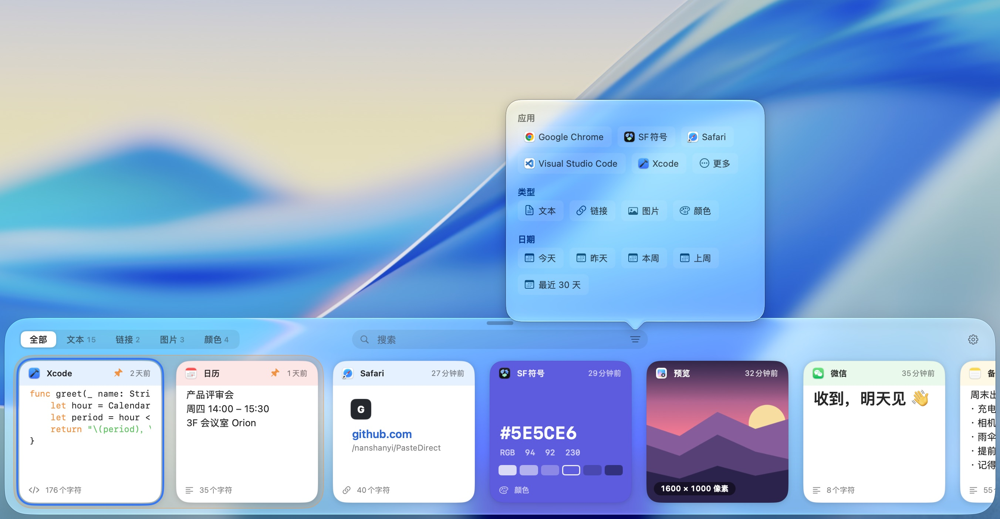
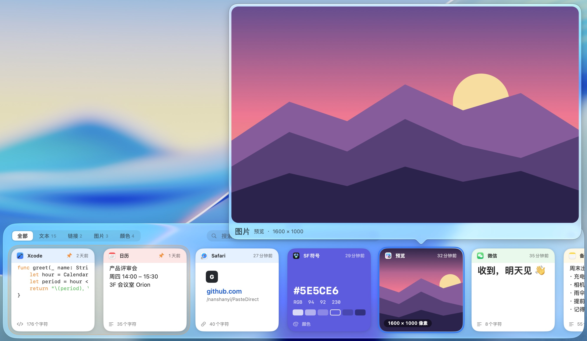

<p align="center">
  
</p>

<h1 align="center">PasteDirect</h1>

<p align="center">
  A lightweight, secure, local-only clipboard history manager for macOS
</p>

<p align="center">
  <a href="https://github.com/nanshanyi/PasteDirect/releases/latest"></a>
  <a href="https://github.com/nanshanyi/PasteDirect/releases"></a>
  
  
  <a href="LICENSE"></a>
</p>

<p align="center">
  <a href="https://github.com/nanshanyi/PasteDirect/releases/latest"><b>⬇️ Download the latest version</b></a>
  ·
  <a href="README.md">简体中文</a> | English
</p>

<picture>
  <source media="(prefers-color-scheme: dark)" srcset="docs/images/main-dark.jpg">
  
</picture>

## Features

### 📋 Captures everything

- **Many formats** — Text, images, HTML, RTF, rich text and code snippets
- **Color detection** — Hex values (with a `#` or `0x` prefix) and `rgb()` / `hsl()` colors are recognized and shown as swatches
- **Link detection** — A single http(s) URL is classified as a link; open it in your browser from the right-click menu or with `⌘` + click
- **Image text recognition (OCR)** — Text in images is recognized on-device with Apple's Vision framework, so images are searchable too
- **Pinned items** — Pin frequently used items so they always stay first and are never auto-cleaned

### 🔍 Finds things fast

- **Instant search** — Just start typing after opening the panel; text inside images is searchable as well
- **Combined filters** — Switch by type (text / link / image / color) with the segmented control (with item counts), and combine with source app and date range filters
- **Space to preview** — Inspect text, images and colors at a larger size; Live Text lets you select and copy text right from image previews

<picture>
  <source media="(prefers-color-scheme: dark)" srcset="docs/images/filter-dark.jpg">
  
</picture>

<picture>
  <source media="(prefers-color-scheme: dark)" srcset="docs/images/preview-dark.jpg">
  
</picture>

### ⚡ Pastes without getting in the way

- **Multiple ways to paste** — Double-click, press Return, or drag to the destination
- **⌘1–9 quick paste** — Hold `⌘` to reveal card numbers, then press a number to paste
- **Plain text** — Choose "Paste as Plain Text" from the context menu, or enable "Always paste as plain text" in Settings
- **Direct paste** — Pastes straight into the previous app after you pick an item, no extra `⌘V` needed

### 🔒 Privacy first

- **Local storage only** — Everything stays in a local SQLite database and nothing is uploaded; the only network request is the update check
- **Ignored apps** — Skip content copied from specific apps such as Keychain or password managers
- **Auto cleanup** — Keep history for 1 day / 1 week / 1 month / forever, or clear it all at any time

### 🪟 Feels native

- Supports the macOS 26 Liquid Glass look and follows system dark / light mode
- Card headers take the source app's accent color so you can tell where content came from at a glance
- Drag the top edge of the panel to resize it; content scales proportionally
- In-app updates powered by [Sparkle](https://sparkle-project.org/)

## Installation

1. Download the latest `.dmg` from [Releases](https://github.com/nanshanyi/PasteDirect/releases/latest) and drag `PasteDirect.app` into Applications.
2. **First launch**: the app uses a self-signed certificate, so macOS will say the developer cannot be verified. Go to **System Settings → Privacy & Security** and click **Open Anyway**. Alternatively, run:

   ```bash
   xattr -cr /Applications/PasteDirect.app
   ```

3. **Grant Accessibility permission** when prompted. It is required to monitor the clipboard and simulate paste.

   

Future versions can be installed from within the app, and the Accessibility permission is kept across updates.

## Usage

Press `⌘⇧V` (customizable) to open the panel, then:

| Action | Description |
|--------|-------------|
| Type | Search; `Backspace` removes filter tags one by one |
| `←` `→` | Move the selection |
| `Return` / double-click | Paste the selected item |
| `⌘` + click | Open a link card in your browser |
| `⌘1` – `⌘9` | Paste the card with that number (hold `⌘` to show numbers) |
| `Space` | Preview the selected item |
| `Delete` | Delete the selected item |
| `Esc` | Close preview / filter popover / clear search / close panel, in that order |
| Drag | Drop a card onto the destination to paste it |
| Right-click | Pin, paste as plain text, copy recognized text, and more |

Hovering over a card reveals pin / delete buttons for quick access.

## Settings

<p align="center">
  
</p>

| Option | Description |
|--------|-------------|
| Launch at login | Start automatically when you log in |
| Menu bar icon | Show / hide the menu bar icon |
| Direct paste | Automatically paste into the current app after selection |
| Always paste as plain text | Strip formatting and paste plain text only |
| Recognize text in images | Run OCR on copied images; when off, text is still available from the context menu |
| History retention | 1 day / 1 week / 1 month / forever |
| Ignored apps | Don't record content copied from these apps |
| Shortcut | Customize the global shortcut |
| Automatic updates | Check for new versions automatically, optionally download in the background and install on quit |

## Privacy & Data

- Clipboard history is stored only on your Mac: `~/Library/Containers/com.nanshanyi.PasteDirect/Data/Library/Application Support/paste/`
- Apart from fetching update information from GitHub Pages ([appcast](https://nanshanyi.github.io/PasteDirect/appcast.xml)), the app makes no network requests.
- To uninstall completely, delete `/Applications/PasteDirect.app` and `~/Library/Containers/com.nanshanyi.PasteDirect`.

## FAQ

<details>
<summary><b>Nothing is pasted after pressing Return / double-clicking?</b></summary>

The Accessibility permission has most likely become invalid. Open **System Settings → Privacy & Security → Accessibility**; if PasteDirect is already listed, remove it with `−`, add it again and turn the switch on.
</details>

<details>
<summary><b>macOS says the app is damaged or the developer cannot be verified?</b></summary>

This is expected for self-signed apps. See step 2 of [Installation](#installation).
</details>

<details>
<summary><b>Why wasn't something recorded?</b></summary>

Check whether the source app is in "Ignored apps", or whether the item was removed by the history retention setting.
</details>

## Building from Source

Requires macOS 13.0+ and Xcode 16+.

```bash
git clone https://github.com/nanshanyi/PasteDirect.git
cd PasteDirect
open PasteDirect.xcodeproj
```

Select the `PasteDirect` scheme and run. Dependencies are fetched automatically by Swift Package Manager.

> [!TIP]
> Launching a Debug build with `-DemoData YES` uses a separate demo database seeded with sample data. It's handy for screenshots and UI work and never touches your real clipboard history.

See [docs/RELEASE.md](docs/RELEASE.md) for the release process and the [CHANGELOG](CHANGELOG_EN.md) for version history.

## Acknowledgements

| Library | Purpose |
|---------|---------|
| [KeyboardShortcuts](https://github.com/sindresorhus/KeyboardShortcuts) | Global shortcuts |
| [SQLite.swift](https://github.com/stephencelis/SQLite.swift) | Local database |
| [SnapKit](https://github.com/SnapKit/SnapKit) | Auto Layout |
| [Sparkle](https://github.com/sparkle-project/Sparkle) | In-app updates |

## Contributing

Bug reports and suggestions are welcome via [Issues](https://github.com/nanshanyi/PasteDirect/issues), and pull requests are appreciated. If you find PasteDirect useful, please give it a ⭐️.

## License

This project is licensed under the [GNU Affero General Public License v3.0](LICENSE).
